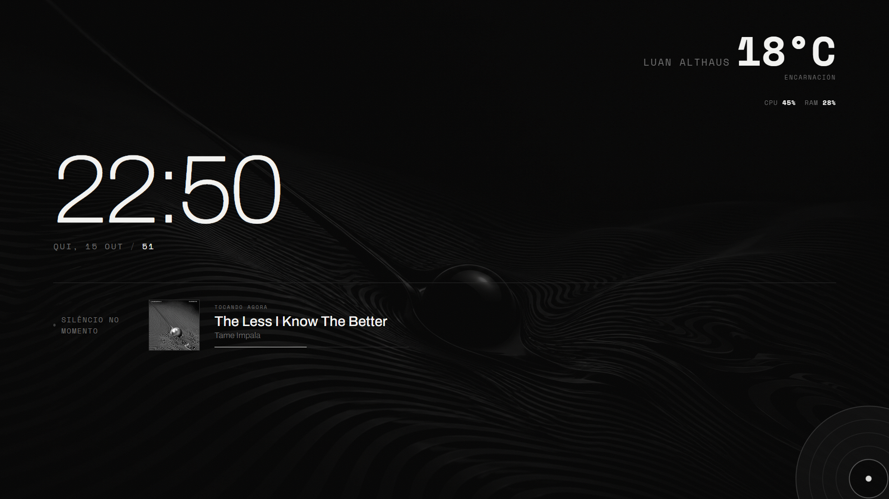

# Painel Spotify

Um painel estilo "dashboard" para deixar numa tela dedicada: relógio grande, o que está tocando no Spotify quase em tempo real, as próximas músicas da fila, temperatura da sua cidade, uso de CPU/RAM do computador e uma frase nova a cada dia — tudo num visual **minimalista noturno**, preto e branco, com fundo de textura.



## O que ele mostra

- **Relógio e data** grandes, em fonte fina
- **Tocando agora** — capa do álbum (em preto e branco), música, artista, barra de progresso e tempos (decorridos e restantes)
  - A barra de progresso anda sozinha, de forma suave, entre as consultas ao Spotify
  - O botão central troca sozinho entre **pause** (tocando) e **play** (pausado)
  - Os botões ⏮ e ⏭ são **só decorativos** — o painel apenas lê o que está tocando, não controla nada
  - Barrinhas discretas e lentas ao lado dos botões, que se movem enquanto toca e param quando pausa
- **Em foco** — as 3 próximas músicas da fila do Spotify
- **Hoje** — a data por extenso e uma **frase do dia**: são 100 frases em um arquivo à parte, e uma nova aparece sempre à meia-noite
- **Temperatura** da cidade que você configurar, com ícone que muda conforme o tempo (sol, lua, nuvem ou chuva) — via Open-Meteo, API gratuita e sem chave
- **Uso de CPU e RAM** do computador onde o painel está rodando
- **Aviso na tela** se o Spotify limitar as consultas ("Spotify em pausa até HH:MM")

Tudo é desenhado num **palco fixo de 1920×1080** que escala automaticamente para qualquer tela. Em telas 16:9 (como 1600×900) ocupa tudo; em outras proporções sobram bordas com o fundo.

## Pré-requisitos

- [Node.js](https://nodejs.org/) versão 18 ou mais recente
- Uma conta Spotify (gratuita ou Premium, tanto faz — o painel só *lê* o que está tocando, não controla nada)

## Passo a passo de instalação

### 1. Clonar o repositório

```bash
git clone https://github.com/LuanAlthaus/spotify-dashboard
cd spotify-dashboard
```

### 2. Instalar as dependências

```bash
npm install
```

### 3. Criar um app no Spotify Developer Dashboard

O painel precisa de credenciais suas para poder consultar "o que está tocando agora" na sua conta.

1. Acesse https://developer.spotify.com/dashboard e faça login com sua conta Spotify
2. Clique em **Create app**
3. Preencha:
   - **App name**: qualquer nome (ex: "Meu Painel")
   - **App description**: qualquer descrição
   - **Redirect URI**: `http://127.0.0.1:4123/callback`
     - ⚠️ Precisa ser **exatamente** esse endereço (incluindo a porta `4123`). Se você mudar a porta no `.env` mais tarde, precisa atualizar aqui também.
4. Marque a caixa de concordância e clique em **Save**
5. Dentro do app criado, clique em **Settings** e copie o **Client ID** e o **Client Secret**

### 4. Configurar as variáveis de ambiente

```bash
cp .env.example .env
```

Abra o arquivo `.env` em um editor de texto e preencha com os dados que você copiou no passo anterior:

```
SPOTIFY_CLIENT_ID=seu_client_id_aqui
SPOTIFY_CLIENT_SECRET=seu_client_secret_aqui
SPOTIFY_REDIRECT_URI=http://127.0.0.1:4123/callback
PORT=4123
```

### 5. Personalizar o painel (nome, cidade e clima)

Copie o modelo de configuração:

```bash
cp public/config.example.js public/config.js
```

Abra o `public/config.js` e edite os seus dados:

```javascript
const CONFIG = {
  displayName: 'seu_nome',     // Nome mostrado no topo
  cityName: 'Sua Cidade',      // Cidade mostrada abaixo da temperatura
  latitude: -25.4284,          // Latitude da sua cidade
  longitude: -49.2733,         // Longitude da sua cidade
};
```

Para achar a latitude/longitude da sua cidade, pesquise por "[nome da sua cidade] coordenadas" no Google, ou use https://www.latlong.net/.

> O `public/config.js` está no `.gitignore`: seus dados pessoais **não vão para o GitHub**, e você pode atualizar o projeto com `git pull` sem conflitos.

### 6. Rodar o painel

```bash
npm start
```

Você verá no terminal:

```
Painel rodando em http://localhost:4123
Se ainda não conectou o Spotify, acesse http://localhost:4123/login uma vez.
```

### 7. Conectar sua conta Spotify (só na primeira vez)

Abra no navegador: **http://127.0.0.1:4123/login**

Você será redirecionado para autorizar o app na sua conta Spotify. Depois de autorizar, vai aparecer uma mensagem de sucesso — pode fechar essa aba. Isso cria um arquivo `tokens.json` na pasta do projeto, que guarda sua autorização (você não precisa fazer login de novo depois disso).

### 8. Abrir o painel

Acesse **http://127.0.0.1:4123** no navegador. Pronto — o painel está funcionando.

## Estrutura do projeto

```
spotify-dashboard/
├── server.js                # Backend: autenticação Spotify, now-playing, fila e CPU/RAM
├── .env.example             # Modelo das variáveis de ambiente
├── package.json
└── public/
    ├── index.html           # Estrutura da página (palco 1920x1080)
    ├── style.css            # Visual (cores, fontes, posições)
    ├── script.js            # Lógica: relógio, now-playing, fila, barrinhas, clima, CPU/RAM
    ├── frases.js            # As 100 frases do dia
    ├── config.example.js    # Modelo da configuração pessoal (copie para config.js)
    ├── config.js            # Sua configuração (criado por você, fora do GitHub)
    ├── fundo.png            # Imagem de fundo
    └── fonts/               # Fontes locais (funciona sem internet)
```

## Personalização

- **Nome, cidade e coordenadas**: `public/config.js` (passo 5 acima)
- **Frases do dia**: `public/frases.js` — é uma lista simples, edite, troque ou acrescente frases à vontade (o ideal é até uns 45 caracteres, para caberem em 2 linhas). O painel mostra uma por dia, na ordem, e troca à meia-noite.
- **Fundo**: substitua o `public/fundo.png` por outra imagem (de preferência escura e em 1920×1080 ou maior)
- **Cores**: variáveis `:root` no topo de `public/style.css` (`--ink`, `--void`, `--mid`, `--line`)
- **Fontes**: Manrope (relógio e títulos), Inter (textos) e IBM Plex Mono (data e legendas), todas em `public/fonts/` e declaradas no topo do `style.css`. As três são livres (licença SIL OFL).
- **Frequência de atualização**:
  - Spotify: `INTERVALO_MS` (3 s tocando) e `INTERVALO_PAUSADO_MS` (6 s pausado ou sem música), no começo do bloco "Tocando agora" do `script.js`
  - Fila "Em foco": ao trocar de música e a cada 60 s
  - Clima a cada 10 min, CPU/RAM a cada 5 s

## Rodando em tela cheia (opcional)

Se você quiser deixar isso ligado numa tela dedicada (tipo um monitor extra ou tablet), abra o navegador em modo kiosk/tela cheia apontando pra `http://127.0.0.1:4123`. No Chrome/Chromium, isso pode ser feito com a flag `--kiosk`. O cursor do mouse fica escondido na página. Esse modo de uso é opcional — o painel funciona normalmente como uma aba comum do navegador.

## Atualizando o projeto

```bash
git pull
```

Se o `server.js` mudou, reinicie o processo Node (`Ctrl+C` e `npm start` de novo, ou reinicie o serviço, se você usa um). Mudanças só no `public/` precisam apenas de recarregar a página (`Ctrl+Shift+R`, para ignorar o cache).

## Prevenção de bugs (Troubleshooting)

### "INVALID_CLIENT: Invalid redirect URI" ao acessar /login

A URL de redirecionamento no Spotify Dashboard (passo 3) precisa ser **idêntica, caractere por caractere**, à `SPOTIFY_REDIRECT_URI` do seu `.env`. Confira se não tem `/` sobrando no final, se a porta bate, e se é `http` (não `https`).

### A tela mostra "Spotify em pausa até HH:MM"

O Spotify limita quantas consultas cada app pode fazer (erro 429) e mandou o painel esperar. O painel para de consultar sozinho e volta no horário indicado — não precisa fazer nada, e recarregar a página não adianta. Para evitar isso, mantenha os intervalos do `script.js` em 3 s ou mais; se mesmo assim acontecer, aumente o `INTERVALO_MS`. O limite exato não é divulgado pelo Spotify e é mais baixo para apps em modo desenvolvimento.

### O painel mostra "Silêncio no momento" mesmo com música tocando

- Confirme que o Spotify está **realmente tocando** em algum dispositivo (celular, PC, alto-falante) — a API só retorna dados se houver reprodução ativa
- Sessões privadas do Spotify (modo anônimo) não aparecem na API
- Espere alguns segundos — o painel atualiza a cada 3 segundos

### A tela fica sem nome ou em branco, ou o console mostra "CONFIG is not defined"

O arquivo `public/config.js` não existe. Crie-o a partir do modelo (passo 5): `cp public/config.example.js public/config.js`.

### O bloco "Em foco" não aparece

Ele só aparece quando há música tocando e o Spotify devolve músicas na fila. Se a fila estiver vazia, o bloco fica escondido.

### Erro "NOT_AUTHENTICATED" no terminal

O arquivo `tokens.json` não existe ou está inválido. Acesse `/login` de novo (passo 7) para gerar um novo.

### CPU e RAM sempre mostram "--%"

O backend (`server.js`) precisa estar rodando a versão mais recente do código. Diferente do frontend (que só precisa de F5 na página), mudanças no `server.js` exigem **reiniciar o processo Node** (`Ctrl+C` e `npm start` de novo).

### A temperatura sempre mostra "--°C"

- Confirme que `latitude` e `longitude` no `config.js` (passo 5) foram preenchidas corretamente, com o sinal de menos quando aplicável (ex: `-25.4284`, não `25.4284`)
- Confirme que o computador tem acesso à internet — a API do clima (Open-Meteo) precisa de conexão externa

### A temperatura mostrada é um pouco diferente de outros apps de clima

Isso é normal — cada serviço meteorológico usa modelos de previsão diferentes, então uma diferença de 1-2°C entre fontes é esperada. Não indica erro.

### Erro "EADDRINUSE" ou "porta já em uso" ao rodar npm start

Outra coisa já está usando a porta 4123. Ou feche o que está usando essa porta, ou mude o valor de `PORT` no `.env` (lembrando de atualizar também a `SPOTIFY_REDIRECT_URI` e o Redirect URI no Spotify Dashboard para bater com a nova porta).

### npm install falha ou dá erro de versão

Confirme que está usando Node.js 18 ou mais recente: `node --version`. Versões mais antigas podem não suportar alguns recursos usados no projeto.

## Licença

Sinta-se livre para usar, modificar e distribuir este projeto.
